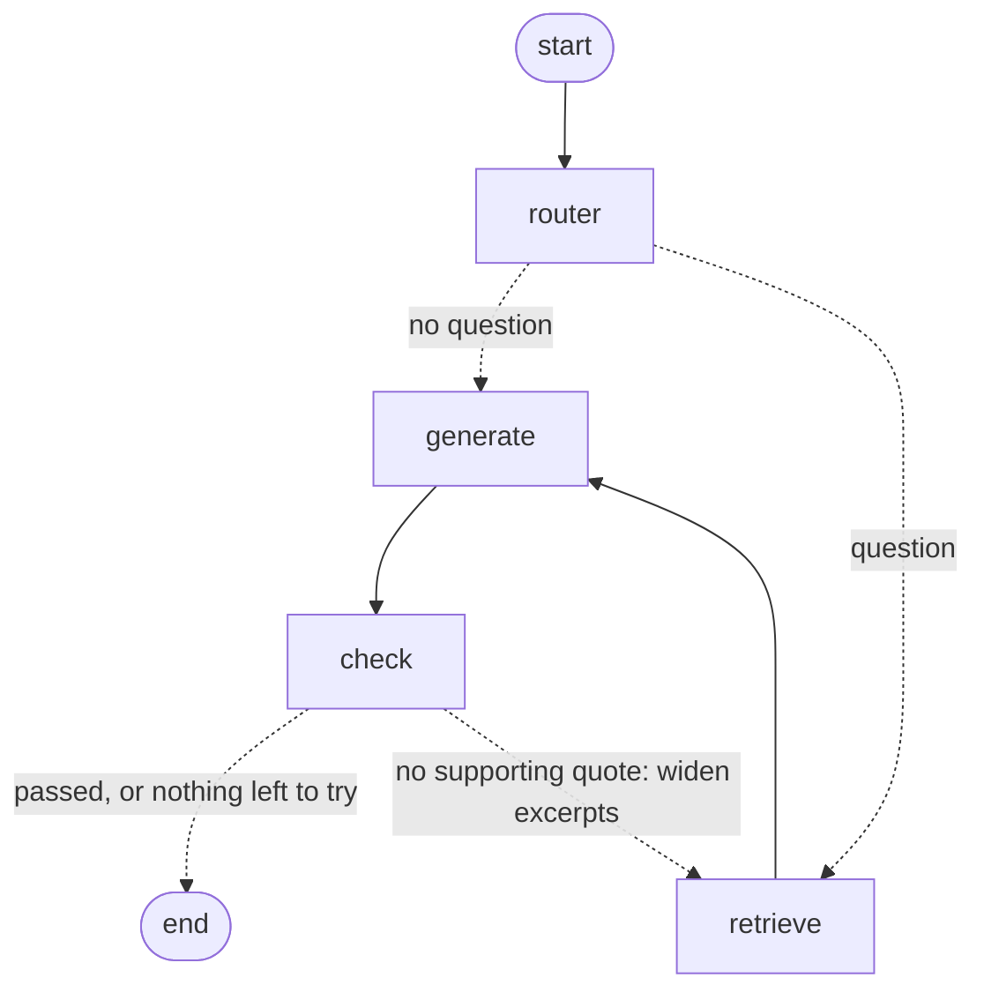

# Resume-to-JSON Extractor

Local, open-weight LLM extracts structured resume data. Prompt-engineered system prompt
(rules + few-shot), Pydantic schema enforcement, Ollama structured-output constraint,
and an [Instructor](https://python.useinstructor.com/) validate-retry loop. Includes
prompt-injection defense against instructions hidden inside resume text. A four-node
LangGraph adds question answering over the same resume.

## Setup

```bash
pip install -r requirements.txt
ollama pull llama3.1        # or mistral, qwen2.5, etc.
ollama serve                # if not already running
```

## Run

```bash
python cli.py path/to/resume.txt
python cli.py resume.txt --model mistral -o resume.json
python graph.py resume.txt                          # extract through the graph
python graph.py resume.txt --ask "Which databases?" # answer with supporting quotes
python graph.py --draw                              # print the graph as Mermaid
```

## Graph



- `router` picks extraction or question answering.
- `retrieve` ranks resume chunks against the question. It is a word-overlap placeholder.
- `generate` calls Instructor, which handles schema validation and retries.
- `check` judges usefulness. A failed question loops back at most `MAX_ATTEMPTS` times in total.

## Validation

Instructor sends each validator error back to the model, then retries.

- Names, emails, companies, schools, projects, certifications, and quotes must appear in the
  source text. This catches values leaked from the few-shot examples.
- Instructor renders messages as Jinja templates when `context` is set. Pass untrusted text only
  as a `context` variable (`{{ resume_text }}`), never inline in a message.

## Test

```bash
pip install pytest
python -m pytest
```

Tests replay scripted LLM replies, so they need no Ollama server.

## Files

- `schema.py` — Pydantic models and validators defining the target JSON shape
- `prompt.py` — system prompts, injection-defense rules, few-shot example
- `extractor.py` — calls Ollama through Instructor (`Mode.JSON_SCHEMA`)
- `graph.py` — LangGraph skeleton: router, retrieve, generate, check
- `cli.py` — command-line entry point

## Extending

- Swap `DEFAULT_MODEL` in `extractor.py` for any local model tag pulled via `ollama pull`.
- Add more `FEW_SHOT` pairs in `prompt.py` for edge cases (multi-column resumes, non-English, etc.).
- Add a batch mode in `cli.py` to loop over a directory of resumes.
